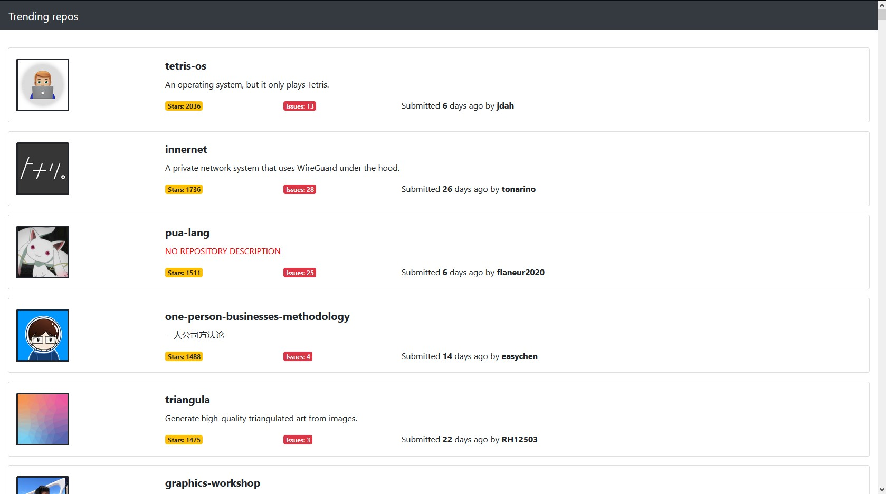
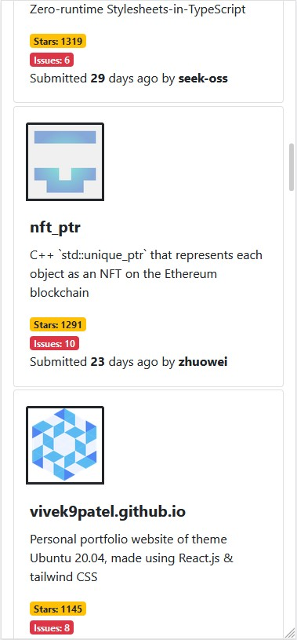
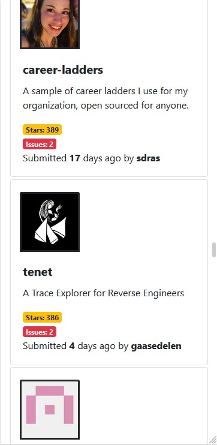

# Infininate scroll list for GitHub repos

## Description

Frontend web application created with React.js to infinate scroll all the github repositories submitted in the last 30 days from the current date. If there is no repository description the application there will be a placeholder saying there is not repository description

## How to run

1. Clone the repository with `git clone https://github.com/PrintfvsCout/frontend-github-lists`
2. Use `npm install` to install all the dependencies
3. Use `npm start` to run the project

## Libraries used

- **React Bootstrap** - For easily creating and styling the components, all bootstrap components are responsive and customizable so this saves a lot of time for writing responsive CSS
- **Axios** - For making easy calls to the api
- **Moment.js** - Used to easily manipulating dates in a nice readable code
- **Infinate scroll** component - Most popular and optimized component for scrolling to the end of pages and getting data instead of reinventing the wheel with my own component

## Screenshots

**Mozzila full screen screenshot**

## Devices with smaller screen

**iPhone X screenshot**

**Android 7**

